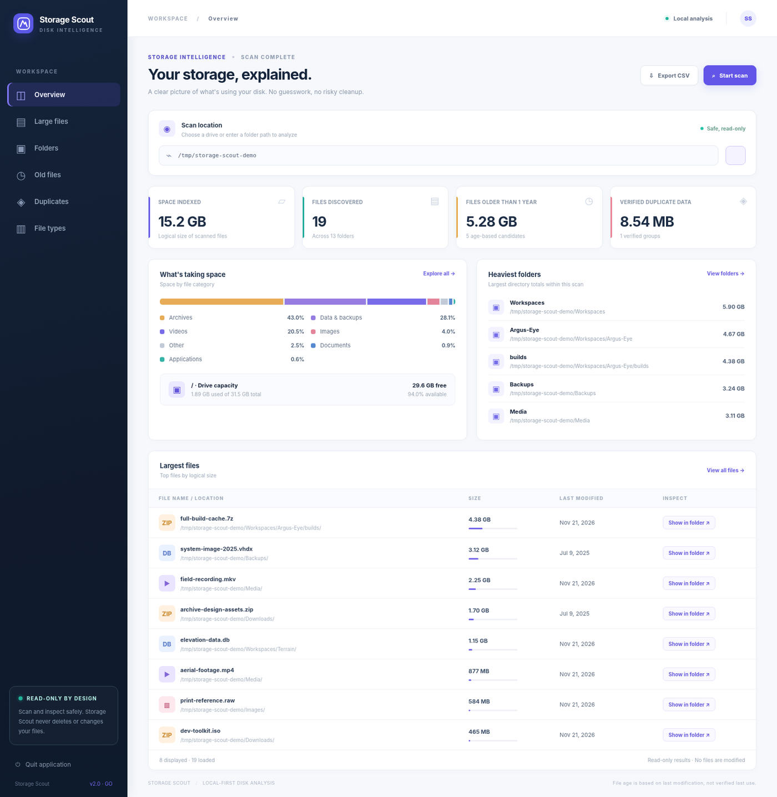
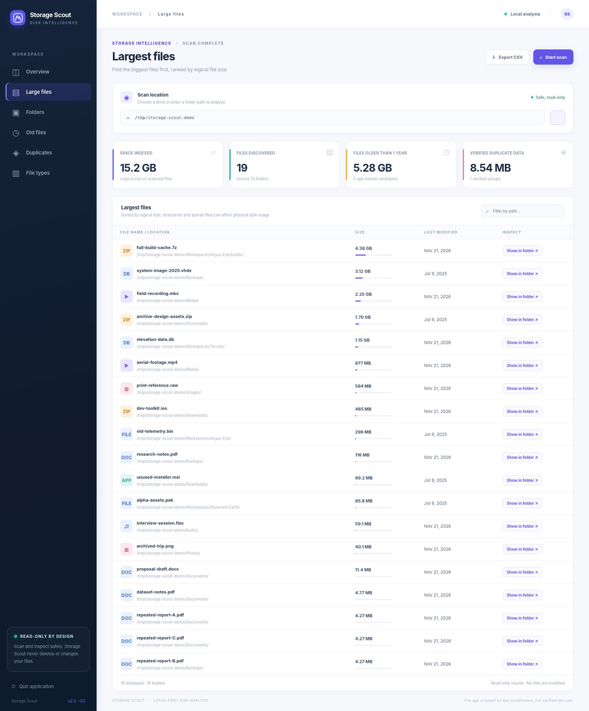
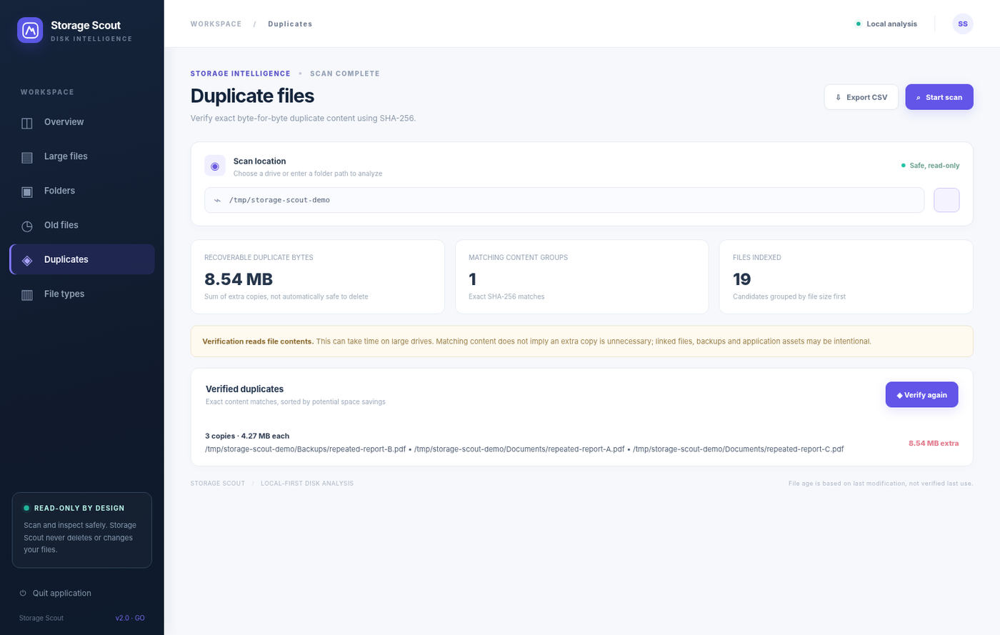

# Storage Scout

A **read-only Windows disk analyzer** built in **Go** with a professionally styled Chromium/Edge desktop interface. It ranks large files and folders, highlights files unchanged for a year, summarizes storage by file type, and optionally verifies duplicates using SHA-256.



> **Screenshot provenance:** These images show the real Storage Scout frontend populated with the Go scanner's output from a dedicated local demonstration directory. The demonstration used sparse files, so *logical file size* can be greater than actual blocks consumed on the disk. Screenshots were rendered in Chromium from the same shipped HTML/CSS/JS, using captured JSON from the running backend. They are not an actual Windows desktop capture and do not represent the user's drives.

## Download and run

Download the portable Windows x64 executable from [GitHub Releases](../../releases/latest). No installation is required. The release also includes `SHA256SUMS.txt` for integrity verification. Development builds remain available from [Actions workflow artifacts](../../actions/workflows/windows.yml). Alternatively, compile directly from source:

```powershell
# Windows 10/11, Go 1.23+ (no Python, Node.js, CMake, or third-party Go modules)
git clone https://github.com/Cryosimorgh/Storage-Scout.git
cd Storage-Scout
go build -trimpath -ldflags="-s -w -H windowsgui" -o StorageScout.exe .
.\StorageScout.exe
```

**Runtime requirement:** Microsoft Edge for a desktop-style application window. Edge's `--app` mode gives a standalone window without browser tabs or address bar; if Edge isn't found, Storage Scout uses the default browser. This is a **local browser-hosted desktop UI**, not an embedded WebView2 or fully native widget window. All scanning and processing runs in the Go executable. No internet connection or account is needed. Application files are bundled in the executable.

The app listens only on a random `127.0.0.1` port and opens the UI with a cryptographically random session key. The local server stays alive until **Quit application** is clicked (or the process is terminated). It does not upload file names or data.

## Screenshots

### Overview — scan size, file counts, old-file candidates, categories, and top folders


### Large files — searchable inventory, size ranking, modified dates, and Explorer access



### Duplicates — verified matching content and potential duplicate bytes



## Features

| Tool | What it does | What it **doesn't** claim |
| --- | --- | --- |
| Drive/folder scan | Walks a selected path read-only, totals logical file size, tracks inaccessible entries | Does not measure deduplicated physical allocated blocks |
| Largest files | Lists up to 1,500 large files and supports text filtering; scan inventory includes all files | Does not modify or remove files |
| Folder breakdown | Totals descendant file sizes for each folder | Parent and child totals overlap; do not add folder totals together |
| Old-file candidates | Finds files with last modification older than 365 days | **Not proof of unused files**; reliable access timestamps are not universally available |
| Duplicates | Groups by file size, then hashes full candidate contents with SHA-256 | Matches may be intentional backups or hard links; no automatic deletion |
| CSV export | Exports every ranked matching row from the completed scan | Large CSV files can take time and require disk space |
| Reveal | Selects a scanned file or folder in Windows Explorer | No move, rename, compress, quarantine, or delete |

The scan is in-memory and is reset when you start a new scan. Large trees take time and may consume hundreds of MB of RAM; progress and cancellation are available. Duplicate verification reads matching-size files, and may consume considerable disk I/O. The scanner skips symlinks and junctions rather than traversing them. Inaccessible or changed entries are counted rather than silently claimed as scanned.

## Architecture

- `main.go`: localhost-only HTTP API, session authorization, CSV export, app bootstrap and lifecycle.
- `internal/scan/scanner.go`: file inventory, category classification, descendant folder sizes, age filter, SHA-256 duplicate verification, cancellation.
- `internal/platform/`: Windows disk capacity via `GetDiskFreeSpaceExW`, Explorer integration, and Edge app-mode launcher; fallback for development on Linux.
- `ui/`: static HTML, CSS and JavaScript, embedded into the Go binary with `//go:embed`.

Everything in the build is the Go standard library. No Go module downloads are needed. Tests cover scan accounting, directory aggregation, duplicate verification, cancellation/error paths and file classification.

## Development

```sh
go test ./...
go vet ./...
go run . -no-browser -port 19440 -root /path/to/test/directory
```

`-no-browser` displays the private URL in the terminal; open it in your browser. A new random session key is generated each start. Scan any accessible path using the UI. On Windows, `-root "C:\\"` sets the initial scan location.

Build a Windows executable from Linux (cross-compilation):

```sh
GOOS=windows GOARCH=amd64 CGO_ENABLED=0 go build -trimpath -ldflags='-s -w -H windowsgui' -o StorageScout.exe .
```

CI runs the Go tests and builds the Windows executable, publishing it as a workflow artifact. The [release workflow](../../actions/workflows/release.yml) additionally runs tests and vet before publishing a versioned portable executable and SHA-256 checksum. To publish a new version, run that workflow from `main` with an unused `vMAJOR.MINOR.PATCH` version or push a new version tag. Existing releases are not overwritten. CI does **not** exercise Windows Explorer or Edge app-mode launch. Test the compiled executable on Windows before treating the app as fully platform-qualified.

## Privacy and safety

- Scanning, hashing and file summaries happen locally; nothing is uploaded.
- The HTTP server binds only to loopback; API calls require a random per-process session key, and cross-origin POST requests are blocked.
- No delete, cleanup, compression or filesystem mutation endpoints exist.
- `Show in folder` only accepts paths present in the active scan.
- File size is **logical length** (`os.FileInfo.Size`); sparse files, NTFS compression, ReFS block sharing, and hardlinks can mean actual physical usage differs.
- If the scan is cancelled, current partial totals are not presented as a complete result.

## Limitations / planned improvements

- A native in-process WebView2 host would remove the Edge app-mode dependency and tie application lifetime to the window.
- The file inventory is kept in memory; a disk-backed index is desirable for multi-million-file drives.
- Folder picker, NTFS allocated-size and hardlink awareness, scan persistence, and Windows installer are future candidates.
- Only Windows x64 is a published target; Linux support is for development and UI tests.

## License

MIT — see [`LICENSE`](LICENSE).